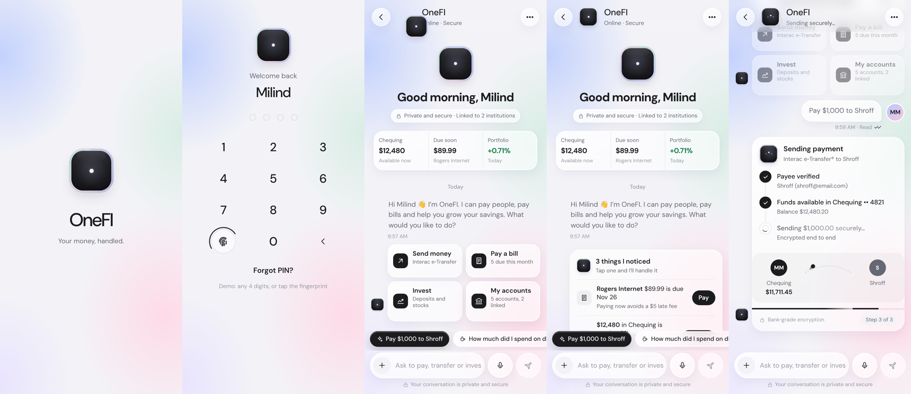
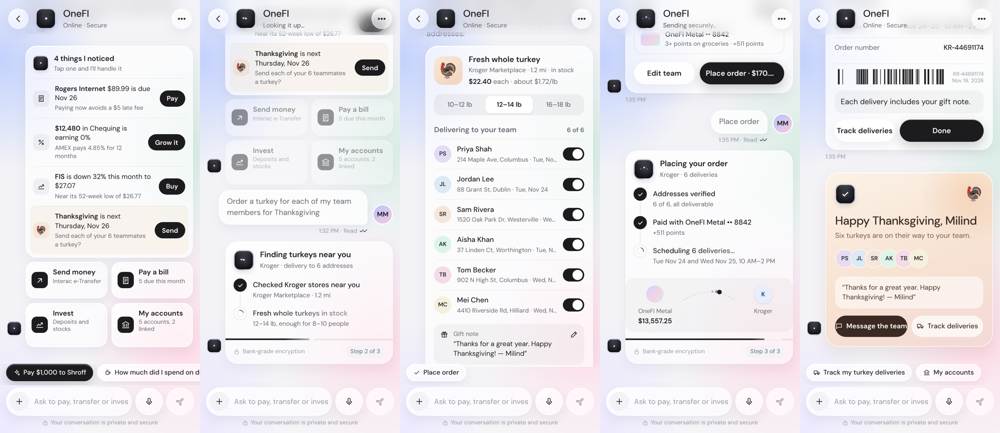

# OneFI: AI banking super-app prototype

OneFI is a clickable, offline prototype of a banking, payments and investing app with an AI assistant at its centre. It runs as an Android APK with no backend: all data is simulated, and the assistant's "thinking" and processing steps are staged so the app can be demoed end to end.

Download the latest APK: [apk/OneFI-v1.7.3.apk](apk/OneFI-v1.7.3.apk).



## What's in it

- **OneFI, the assistant.** Ask in plain words, by typing or by voice, and it works through each request step by step:
  - pay a person, or pay a bill
  - open a term deposit
  - buy shares through a linked brokerage
  - answer spending and savings questions
- **Halo.** The assistant's mark is a graphite squircle with one soft dot. The dot shows what kind of work is happening: verifying, sending money, comparing rates, investing, waiting for your OK, and so on (15 states in all). When idle, it only breathes and occasionally glances at something that needs you.
- **"Things I noticed."** On open, OneFI scans the accounts and lists what needs attention, with one tap to act.
- **Money moving.** On the last step of a payment, a dot travels from your account to the recipient while your balance counts down.
- **Banking around it.** Accounts, cards, investing, bills, goals and profile, all updating as the assistant acts.

## Demo flow

1. Pay $1,000 to Shroff.
2. Pay the Rogers internet bill ($89.99).
3. Open a $5,000 AMEX term deposit at 4.85% for 12 months (+$242.50).
4. Buy 500 FIS through E*TRADE at $27.07.
5. Order a Thanksgiving turkey for each of six teammates from Kroger, paid with the OneFI Metal card.

Any 4‑digit PIN, or the fingerprint button, unlocks the app and confirms actions. The ⋮ menu in OneFI has a demo mode that types each step for you, and an option to restart the demo.



## Install

Download [`apk/OneFI-v1.7.3.apk`](apk/OneFI-v1.7.3.apk) and open it on an Android phone (Android 7.0 or later). You'll need to allow installs from your browser or file manager. The APK is signed with a self-signed key.

## Build from source

The APK is assembled without the Android SDK: custom Python tools write the DEX bytecode, binary manifest and resources, then zip and sign the result.

```bash
pip install cryptography pillow numpy
python3 tools/icons.py halo   # launcher icons -> build/icons
python3 tools/build.py        # -> build/SuperBank.apk
```

A new signing key is generated in `build/` on the first build. Keep it, because Android only installs an update over an app signed with the same key.

The app itself is plain HTML, CSS and JavaScript in `web/`. To preview it in a browser, open `build/index.html` after a build, or open `web/index.html` directly. Add `?skip=1` to the URL to jump past the intro and lock screen.

### Tests

`tools/flow.py` clicks through every screen, and `tools/story.py` replays the demo storyboard. Both need Playwright with Chromium (`pip install playwright && playwright install chromium`).

## Project layout

```
web/            the app: index.html, css/, js/, fonts/
tools/          dex.py, apk.py, shell.py (WebView shell + speech), build.py, icons.py, tests
docs/           screenshots
apk/            the latest built APK
```

## Notes

- All people, balances, addresses and orders are made up. Brand names (Rogers, AMEX, E*TRADE, Kroger, Interac) appear as text only, for the demo story.
- Fonts are open-source (SIL Open Font License): DM Sans, Inter, Outfit, Instrument Sans/Serif, Geist Mono.
